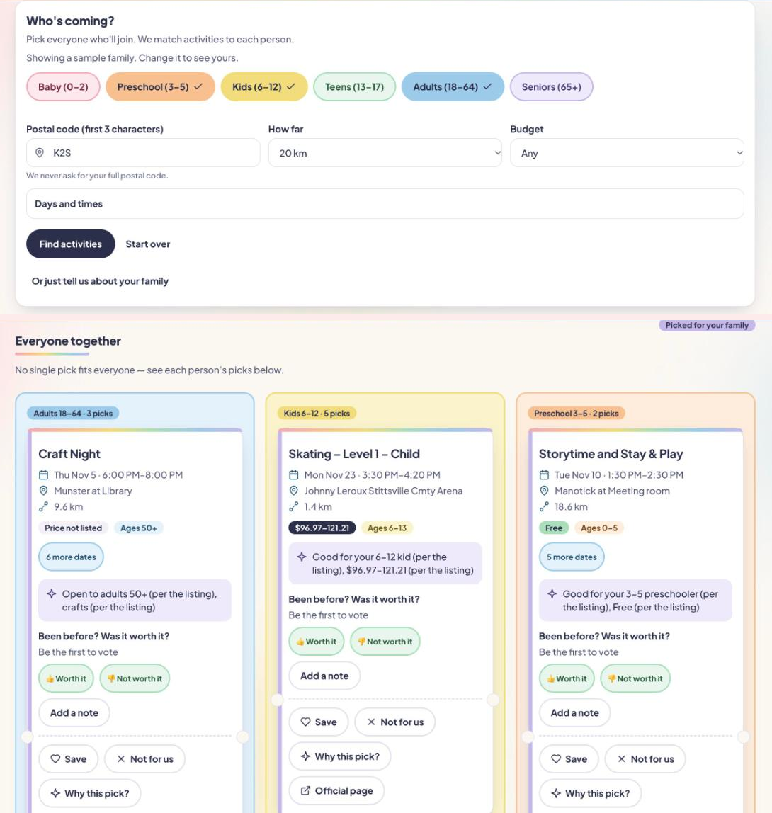
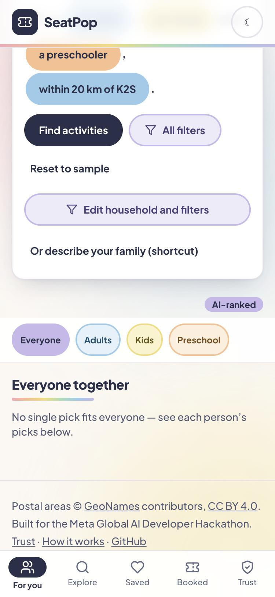
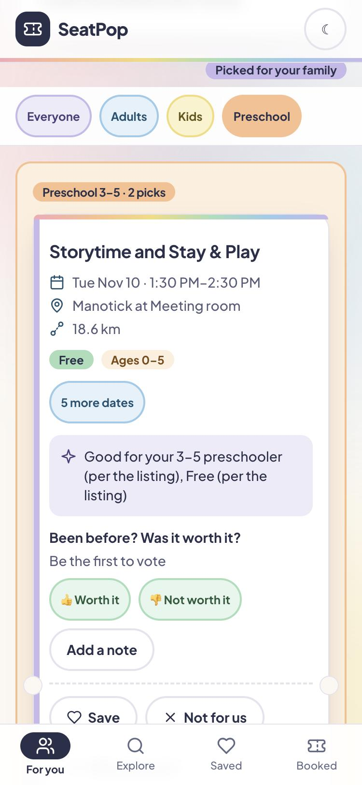
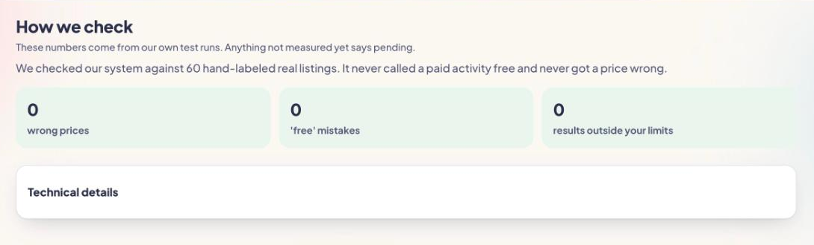

# SeatPop

**Find what's coming next for everyone in your household, and know when to register.**

SeatPop takes a household as age bands (never names or birth dates) and
shows, for Ottawa, the activities that fit each person, free or paid, plus
the ones that work for everyone together. Every price, age range and
date shown is backed by a verbatim quote from the official listing, with
a link to it. It is about *what is coming next and when registration
opens*, not live seat counts, which would need tight, time-sensitive
integration with every booking site.

Built for the Meta Global AI Developer Hackathon (Indie track, "Build for
Your World"). Guest-first: results with no sign-up.

- **Live:** https://seat-pop.vercel.app
- **Trust page (evals, rendered live):** https://seat-pop.vercel.app/trust
- **About:** https://seat-pop.vercel.app/about



<p>
  
  
</p>

## Why it matters

Parents plan around three questions: *does it fit each of my kids, can
we afford it, and when do I have to register?* Listings answer them in
different places, in different formats, and registration windows are
easy to miss. SeatPop answers all three in one view and never states
something the listing does not say.

## How it works

1. **The LLM proposes, the verifier disposes.** Every model-extracted
   value (price kind, amounts, ages, registration hints) must ground in
   a verbatim quote from the event's own text, or it is dropped. "Free"
   is never stated without an explicit signal.
2. **Hard constraints run in SQL.** Age fit, budget, distance, time
   windows, language and accessibility filter candidates in a Postgres
   RPC *before* any ranking. A model that names an event outside the
   candidate set is discarded.
3. **Per-member fit, then grouping.** Each person gets exact / adjacent /
   unknown fit levels. The web layer builds an "Everyone together" row
   and one column per member; recurring series collapse to "+N more
   dates".
4. **Rerank with a safety net.** Muse Spark reranks the top candidates
   with *stated vs inferred* reasons. If the model is down, over budget
   or returns invalid JSON, the deterministic stage-2 order is served
   with templated reasons.
5. **Registration windows.** Official City registration dates are
   transcribed by hand with a verbatim quote and link, and shown only on
   events they apply to (a swim window matches swim events only).
6. **Privacy by design.** Age bands only; the postal area is an FSA, never
   a full postal code or address. Typed household text is redacted and
   discarded. Emails are treated as untrusted input.
7. **Polite crawling.** robots.txt honored, rate limits, an honest user
   agent, loud failures, and no bypassing of 403s or login walls.
   Owner-transcribed facts are never crawled.

## Eval results

Recommendation eval: 20 synthetic households, relevance graded by Muse
Wonder (labeled model-graded; 11 of 20 households graded).

| | Mean NDCG@10 |
| --- | --- |
| **Reranked (Muse Spark)** | **0.875** |
| Stage-2 order only | 0.779 |
| Date order | 0.738 |

Constraint violations in every top 10: **0**. Distance mismatches: **0**.
Policy probe ok, and the no-key fallback is proven by a key-removed run.

Enrichment eval on 60 hand-labeled events (59 scored, one excluded as
ambiguous with the reason recorded): **false-"free" 0, wrong-price 0**
on all three models; price kind and amount accuracy 100%. A failed first
run (prompt v4) was diagnosed per event and fixed in the prompt, not by
editing labels or thresholds. Full report and failure analysis:
[docs/eval-report.md](docs/eval-report.md). The golden labels were
drafted by AI and reviewed by the author, and the grades are model-graded:
treat the numbers as a regression guard, not a benchmark claim.



## Meta models and tools

- **Muse Spark 1.3** (Meta API): reranks the top candidates with
  stated-vs-inferred reasons; `profile_parse` turns typed household text
  into editable fields; `booking_parse` reads redacted booking
  confirmations. Household and email tasks are limited to standard Meta
  models, never the contributor model and never Baseten.
- **Muse Spark 1.3 contributor** (Meta API): listing extraction and
  enrichment voting over public listing text only.
- **Muse Spark Open on Baseten (open weights)**
  (`meta-models/muse-spark-open-1026`): serves the no-training route
  exclusively and shares public-text extraction otherwise, under spend
  caps. In the enrichment eval it matches the hosted models on every
  scored field at about $4.72 per 1,000 events.
- **Muse Wonder 1.0** (Meta): eval judge producing NDCG relevance grades,
  always labeled model-graded.
- **Muse Code** (Meta): the coding agent that implemented the repository
  from prompts written by the author.
- Interest embeddings are local bge-small vectors, not a hosted call.

All model calls go through one client in `packages/llm` that logs task,
model, tokens, cost and outcome, and enforces budgets from the
environment. Live paths have per-IP and daily caps and a deterministic
fallback, so the app keeps working if the budget runs out.

## Stack

TypeScript npm workspaces: `apps/web` (Next.js App Router, Tailwind),
`worker` (crawl, enrich, eval, seed scripts), `packages/shared`,
`packages/llm`. Supabase (Postgres, pgvector, Row Level Security),
Vitest (835 tests), Vercel.

## Run locally

Requires Node 20+. Secrets live in the repo-root `.env` (never
committed; the client bundle reads none).

```sh
npm install
cp .env.example .env   # fill in: SUPABASE_URL, SUPABASE_ANON_KEY, ...
npx supabase db push   # linked project; applies supabase/migrations
npm run dev --workspace @seatpop/web   # http://localhost:3000
```

Without Supabase credentials the app still runs but shows
not-configured states instead of data. Gates:
`npm run typecheck && npm run lint && npm test`. To serve a production
build: `npm run build --workspace @seatpop/web` then
`npm start --workspace @seatpop/web`. Deploy notes are in
`docs/deploy.md`; per-phase build notes in `docs/progress/`.

## Known limitations

- Pilot city only (Ottawa); venue coordinates for a few entries are
  marked `"verified": false` pending a map check.
- A search takes roughly 10 to 30 seconds on a cold query.
- Some City recreation courses are hand-transcribed from official pages
  (with quote and link) rather than crawled; the crawler covers sources
  whose robots.txt and terms allow it.
- Ages stated as "less than N" are stored with N as the upper bound.
- Not a booking tool: SeatPop links to the official page to register.

## Attribution

- Home-area centroids (migration 0008) are FSA rows used directly from
  the GeoNames free postal code dump (FSA-level lat/lng)
  (https://download.geonames.org/export/zip, © GeoNames contributors,
  CC BY 4.0, https://creativecommons.org/licenses/by/4.0/).
  Ottawa-area K-prefixed FSAs only; method and operator steps in
  `supabase/seeds/ottawa_fsa_from_geonames.py`.
- Venue coordinates (`data/seed/venue-coordinates.json`) for Ottawa
  Public Library branches contain information licensed under the City
  of Ottawa Open Data Licence v2.0
  (https://ottawa.ca/en/city-hall/get-know-your-city/open-data#open-data-licence-version-2-0).
  Museum, theatre and market coordinates cite the venues' Wikipedia
  pages per entry (`source`). City recreation-facility coordinates cite
  their OpenStreetMap objects per entry (`source`), © OpenStreetMap
  contributors, ODbL (https://www.openstreetmap.org/copyright).

## Contributors

Diprish Verma (author, product, review). Implementation by Muse Code
(Meta's coding agent) from the author's prompts.

## Provenance

SeatPop (hackathon edition) was built between Oct 27 and Nov 4, 2026,
from scratch in this repository. It follows an earlier private concept
by the same author (working name RegWatch); no code from it was
carried over. Golden labels were drafted by AI and reviewed by the
author.
